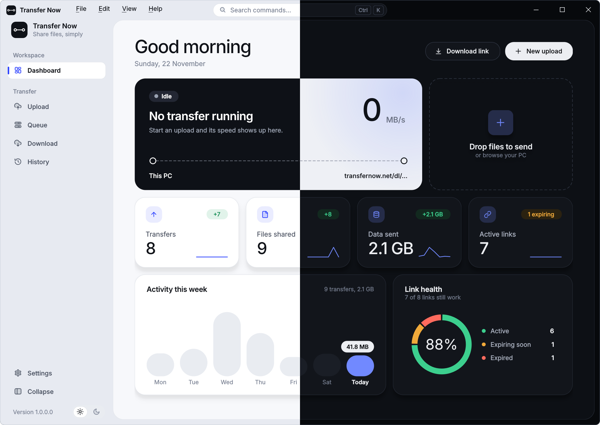

 
<p align="center">
  
</p>

<p align="center">
  
  
  
  
</p>

<p align="center">
  <strong>A modern desktop experience for effortless file transfers.</strong>
  <br>
  Send, receive, manage and track your files through TransferNow, directly from your desktop.
</p>

<p align="center">
  <strong>5 GB per transfer</strong> · <strong>Free</strong> · <strong>No account required</strong> · <strong>Unlimited files per transfer</strong>
</p>

---

## Overview

**Transfer Now** brings the simplicity of TransferNow into a dedicated desktop application. Built with Python and PyQt6, it combines a streamlined interface, powerful transfer management, resumable downloads and an integrated transfer history into one cohesive experience.

Designed to make file sharing feel effortless, without constantly switching between browser tabs.

<p align="center">
  
</p>

---

## Features

### ↗ Send files

Everything you need to send files without unnecessary friction.

- **Instant sharing** — Generate shareable links for transfers up to 5 GB, free of charge and without an account.
- **Folder support** — Add entire folders, including nested directories, without manually selecting individual files or creating ZIP archives.
- **Drag & drop** — Drop files or folders anywhere inside the application.
- **Flexible file selection** — Browse files or add folders directly.
- **Transfer queue** — Manage multiple transfers simultaneously, reorder tasks, retry failed uploads, cancel transfers and copy all generated links.
- **Parallel uploads** — Upload up to 4 transfers simultaneously.
- **Live monitoring** — Track upload progress, transfer speed and estimated completion time.
- **Scheduled transfers** — Schedule uploads and automatically retry failed transfers.
- **Sender customization** — Use a randomly generated sender address or provide your own.

### ↙ Receive files

Download shared files without opening your browser.

- **Link-based downloads** — Paste a TransferNow link and retrieve its contents.
- **File preview** — Review available files before downloading.
- **Custom destination** — Choose where downloaded files should be saved.
- **Pause & resume** — Continue downloads after interruptions whenever supported.

### ◷ Transfer history & monitoring

Keep every transfer organized and accessible.

- **Transfer history** — Track past uploads and downloads.
- **Search & filters** — Quickly find previous transfers.
- **CSV export** — Export transfer history for external use.
- **Link health monitoring** — Check whether saved transfer links are still accessible.
- **QR codes** — Generate QR codes for sharing transfer links.
- **Activity dashboard** — View transfer statistics, weekly activity and link health.
- **Live speed monitoring** — Keep an eye on transfer activity in real time.

### ◈ Designed for desktop

A desktop experience built around convenience and customization.

- **System tray integration** — Keep the application running in the background.
- **Desktop notifications** — Receive updates when transfers complete.
- **Clipboard monitoring** — Detect copied TransferNow links and offer to open them.
- **Multiple themes** — Graphite, Graphite Black, Graphite Blue, Porcelain, Porcelain Warm and System.
- **Accent customization** — Choose from 7 accent colors.
- **Multilingual interface** — English, हिन्दी, Español, Français, Deutsch, Português (BR), 日本語 and 中文.
- **Command palette** — Quickly access application actions with `Ctrl+K`.
- **Keyboard shortcuts** — Navigate and control the application efficiently.

---

## Installation

### Requirements

| Requirement | Details |
|---|---|
| Python | 3.10 or newer |
| Browser | Google Chrome or Microsoft Edge |
| Operating system | Windows, macOS or Linux |
| Internet | Required for transfers |

<caption>Uploading requires Google Chrome or Microsoft Edge because the application automates the browser in the background. Selenium automatically manages the matching browser driver. Downloads require only an internet connection.</caption>

### Get started

Clone the repository:

```bash
git clone https://github.com/Krishnamohangupta08/Transfer-Now.git
cd transfer-now
```

### Run the application

| Platform | Command |
|---|---|
| Windows | Double-click `run.bat` |
| macOS / Linux | `./run.sh` |
| Manual | `pip install -r requirements.txt` followed by `python main.py` |

The first launch automatically creates a private virtual environment and installs the required dependencies.

Core dependencies include PyQt6, Selenium, Requests and optional QR-code support.

---

## Build a standalone application

Build Transfer Now into a standalone desktop application using PyInstaller.

### Install build dependencies

```bash
pip install -r requirements.txt -r requirements-build.txt
```

### Build options

```bash
python build.py
```

| Build mode | Command | Description |
|---|---|---|
| Default | `python build.py` | Builds both single-file and folder-based distributions |
| One file | `python build.py onefile` | Creates a portable executable |
| One directory | `python build.py onedir` | Creates a folder-based application that starts faster |

You can also use the platform-specific build scripts:

- Windows: `build_exe.bat`
- macOS / Linux: `./build_exe.sh`

<caption>Build on the target operating system. PyInstaller does not support cross-compiling applications between operating systems.</caption>

### Application data

Settings and transfer history are stored locally.

| Operating system | Storage location |
|---|---|
| Windows | `%APPDATA%\TransferNow` |

Your settings and history remain available across application updates.

---

## Usage

### 1. Add files

Drop files or folders directly into the application, or use the file browser and folder selection controls on the Upload page.

### 2. Configure your transfer

Select a sender address and optionally schedule the transfer for a later time.

### 3. Generate your link

Press **Get link** or use the `Ctrl+Enter` shortcut.

Your transfer is automatically added to the queue, allowing you to prepare the next transfer while the previous one is running.

### 4. Share your files

Copy, open or scan the generated link. Completed transfers are also automatically added to your history.

<caption>Each transfer is limited to 5 GB in total. When a selection exceeds the limit, files that do not fit are skipped and the application informs you how many files were excluded.</caption>

---

## Keyboard shortcuts

| Shortcut | Action |
|---|---|
| `Ctrl+K` | Open command palette |
| `Ctrl+Enter` | Generate transfer link |
| `Ctrl+Shift+V` | Paste a link and fetch files |
| `Ctrl+Shift+C` | Copy the latest transfer link |
| `Ctrl+L` | Check saved links |
| `Ctrl+B` | Collapse or expand sidebar |
| `F11` | Toggle fullscreen |
| `F1` | View all keyboard shortcuts |

---

## Project structure

```text
transfer-now/
├── main.py
├── core/
│   ├── engine.py          # Upload automation (Selenium)
│   ├── downloader.py      # Link lookup and resumable downloads
│   ├── linkcheck.py       # Transfer link health checker
│   ├── tasks.py           # Background workers
│   └── store.py           # Settings and history storage
├── ui/
│   ├── window, theme, i18n, widgets, tray, dialogs
│   └── pages/
│       ├── dashboard
│       ├── upload
│       ├── queue
│       ├── download
│       ├── history
│       └── settings
├── assets/                # Icons, fonts and application assets
├── docs/                  # README banner and screenshots
├── tools/                 # Utilities and screenshot renderers
├── tests/                 # Automated tests
├── build.py                # PyInstaller build script
├── run.bat
├── run.sh
├── build_exe.bat
└── build_exe.sh
```

---

## Regenerate screenshots

The README screenshots can be regenerated using the screenshot rendering utility.

```bash
QT_QPA_PLATFORM=offscreen QT_SCALE_FACTOR=1.6 python tools/readme_shots.py
```

---

## Testing

### Core tests

```bash
python -m unittest tests.test_core
```

Tests parsing, storage and downloader functionality.

### UI tests

```bash
python -m unittest tests.test_ui
```

Tests application UI flows. Upload-related tests require Chrome.

---

## Important notes

- **Independent project:** Transfer Now is not affiliated with TransferNow.
- **Upload implementation:** Uploads are performed by automating the public TransferNow website through a hidden browser session. Changes to the website may affect upload functionality.
- **Website compatibility:** If the Create a link or Get a link element is no longer detected, the application reports the issue. Relevant selectors are maintained in `core/engine.py`.
- **Link health checks:** Link status detection is best-effort. HTTP 200 is interpreted as active, HTTP 404 or 410 as expired, and other responses as unchecked. TransferNow does not provide a dedicated status API for this implementation.
- **Progress reporting:** When the website does not expose progress information, Transfer Now uses a smooth progress estimate instead of falsely reporting 100% completion.
- **Translations:** Static interface text is translated. Certain engine-generated messages may remain in English.

---

## Author

**Developed by Krishna Mohan Gupta**

© 2026 Krishna Mohan Gupta. All rights reserved.
