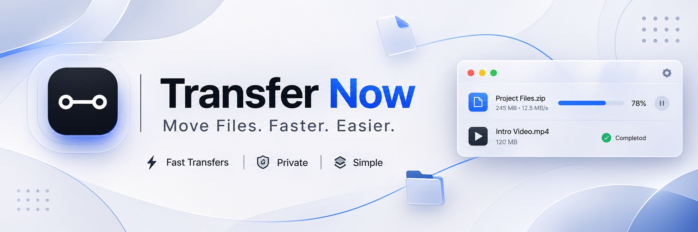
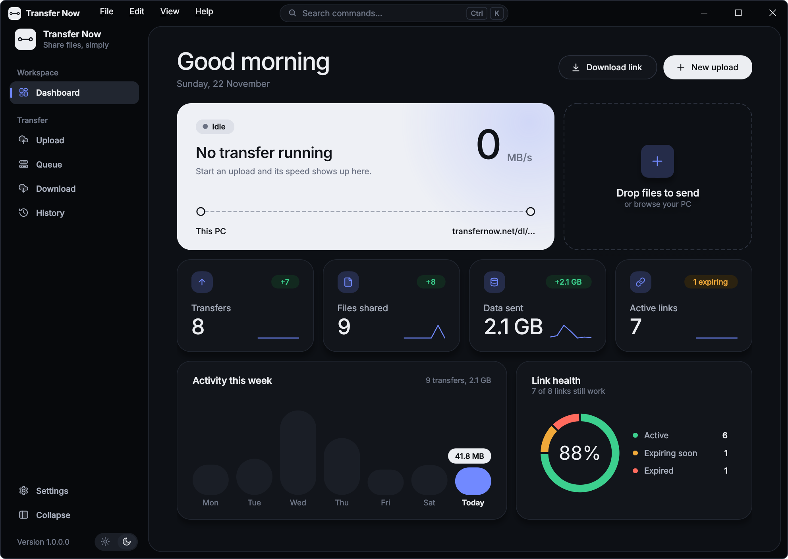
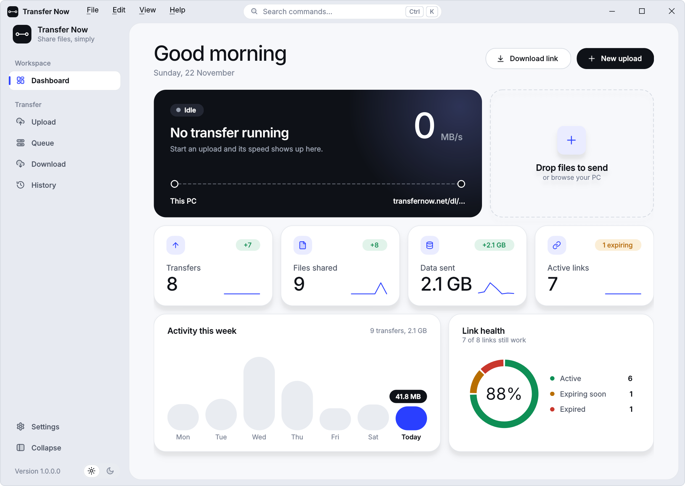

<p align="center">
  
</p>

<p align="center">
  
  
  
  
</p>

<p align="center">
  A fast desktop app for sharing files with <b>TransferNow</b> — free, no account, up to <b>5 GB</b> per transfer
  and up to <b>20 items per transfer</b> (larger selections are zipped for you).
</p>

---

## Screenshots

<table>
  <tr>
    <td align="center" width="50%"><b>Dark</b></td>
    <td align="center" width="50%"><b>Light</b></td>
  </tr>
  <tr>
    <td></td>
    <td></td>
  </tr>
</table>

## Features

**Send**
- 🔗 **Share link in one click** — up to 5 GB per transfer, free, no account; links stay live for 7 days.
- 📁 **Folders just work** — choose or drop a folder and every file inside (subfolders included) is added for you. A transfer holds up to 20 items; if you select more, Transfer Now offers to combine them into one ZIP.
- 🖱️ **Drag & drop anywhere** in the window, or use **Browse files** / **Add folder**.
- 🗂️ **Queue** — many transfers at once, parallel uploads (1–4), reorder, retry, cancel, copy all links.
- 📈 **Live progress** — real percentage, speed graph and ETA on every transfer.
- ⏰ **Scheduled uploads** with automatic retry for failed transfers.
- ✉️ **Sender address** — a fresh random one per transfer, or your own.

**Receive**
- ⬇️ **Download from a link** — paste a TransferNow link, preview the files, choose a folder and save.
  Downloads can be paused and resume after a dropped connection.

**Keep track**
- 🕘 **History** with search, filters and CSV export.
- 🩺 **Link health check** — one click verifies which saved links are still active, plus QR codes for any link.
- 📊 **Dashboard** with a live speed readout, stats cards, weekly activity and link health.

**Desktop comfort**
- 🔔 System tray, desktop notifications and a clipboard watcher that offers to open any TransferNow link you copy.
- 🎨 Light and dark themes (*Graphite*, *Graphite Black*, *Graphite Blue*, *Porcelain*, *Porcelain Warm*, or follow the system), 7 accent colours.
- 🌍 8 languages: English, हिन्दी, Español, Français, Deutsch, Português (BR), 日本語, 中文.
- ⌨️ Command palette (`Ctrl+K`) and keyboard shortcuts for everything (`F1` lists them).

## Getting started

### Requirements

- **Python 3.10+**
- **Google Chrome** or **Microsoft Edge** — needed for uploading (the app drives it in the background; Selenium fetches the matching driver itself). Downloading needs nothing but an internet connection.

### Run

```bash
git clone https://github.com/<your-username>/transfer-now.git
cd transfer-now
```

| Platform | Command |
|---|---|
| **Windows** | double-click `run.bat` |
| **macOS / Linux** | `./run.sh` |
| **Manual** | `pip install -r requirements.txt` then `python main.py` |

The first run creates a private virtual environment and installs the dependencies
(PyQt6, Selenium, requests, psutil and the optional `qrcode`).

### Build a standalone app

```bash
pip install -r requirements.txt -r requirements-build.txt
python build.py              # single file + folder build
python build.py onefile      # one portable executable
python build.py onedir       # folder build (starts faster)
```

On Windows you can also double-click `build_exe.bat`; on macOS / Linux use `./build_exe.sh`.
Build on the platform you are targeting — PyInstaller can't cross-compile.
Settings and history live in `%APPDATA%\TransferNow`, so they survive updates.

## Using it

1. **Add files** — drop files or folders anywhere in the window, or use *Browse files* / *Add folder* on the Upload page.
2. **Pick a sender** and, if you like, schedule it for later.
3. Press **Get link** (`Ctrl+Enter`). The transfer moves into the queue and the form is free for the next one.
4. **Copy, open or scan** the link when it's ready. It also lands in History.

A transfer holds up to **20 items** and **5 GB** in total. Select more than 20 files and Transfer Now offers **Create ZIP and Upload**; files over the 5 GB total are skipped and you're told how many.

### Keyboard shortcuts

| Shortcut | Action |
|---|---|
| `Ctrl+K` | Command palette |
| `Ctrl+Enter` | Get link |
| `Ctrl+Shift+V` | Paste a link and fetch it |
| `Ctrl+Shift+C` | Copy the last link |
| `Ctrl+L` | Check saved links |
| `Ctrl+B` | Collapse / expand the sidebar |
| `F11` | Full screen |
| `F1` | All shortcuts |

## Project layout

```
main.py                 entry point
core/engine.py          upload automation (Selenium, Qt-free, unit-testable)
core/downloader.py      link lookup + resumable download
core/linkcheck.py       link health checker
core/tasks.py           background workers (upload, download, folder scan, link check)
core/procs.py           makes sure no browser process outlives the app
core/store.py           settings + history (atomic JSON)
ui/                     window, theme, i18n, widgets, tray, dialogs
ui/pages/               dashboard, upload, queue, download, history, settings
assets/                 icons (SVG source in assets/icons/), fonts, app icon
docs/                   README banner and screenshots
tools/                  icon export, app-icon maker, screenshot renderers
tests/                  automated tests
build.py                PyInstaller build
```

Regenerate the README screenshots with:

```bash
QT_QPA_PLATFORM=offscreen QT_SCALE_FACTOR=1.6 python tools/readme_shots.py
```

## Tests

```bash
python -m unittest tests.test_core        # parsing, storage, downloader
python -m unittest tests.test_ui          # UI flows (needs Chrome for the upload flows)
```

## Security & build notes

- **Dependency split** — `requirements.txt` is runtime-only; `requirements-build.txt`
  (PyInstaller + Pillow) and `requirements-dev.txt` (ruff, bandit, pip-audit) are kept
  separate, so the `run.sh` / `run.bat` launchers never install build or dev tooling.
- **CI** — `.github/workflows/ci.yml` runs the test suite headless, ruff + bandit, an
  advisory pip-audit scan, and a PyInstaller packaging job per platform (Linux onedir
  with a headless smoke run, Windows onefile, macOS onedir). CI proves the build
  commands run on native runners — the packaged Windows/macOS apps are *not*
  UX-tested there.
- **Packaging paths** — the bundle ships the fonts at `assets/fonts/` (Inter + Inter
  Tight + the OFL license) and the developer photo at `assets/`, matching what the
  frozen app looks up in `main.py` and `ui/about.py`;
  `python -m unittest tests.test_packaging` guards this (and boots the frozen app
  headless when a build is present).
- **Headless testing** — set `TN_DATA_DIR` to redirect settings/history/sounds into a
  scratch folder and `QT_QPA_PLATFORM=offscreen` to run without a display; minimal
  Linux hosts additionally need `libegl1` / `libgl1` for PyQt6 to load.

## Good to know

- **Not affiliated with TransferNow.** Uploads work by automating the public TransferNow website in a hidden browser, so a change to that site can break them. If "Create a link" or "Get a link" stops being found, the app tells you and the selectors to update are in `core/engine.py`.
- The **link checker** is best-effort: HTTP 200 → active, 404/410 → expired, anything else → *Unchecked*. TransferNow has no status API.
- If the site hides its progress bar, the app falls back to a smooth estimate and never shows a fake 100 %.
- Interface translations cover the static UI text; some engine messages stay in English.

## Author

Developed by **Krishna Mohan Gupta**.

© 2026 Krishna Mohan Gupta. All rights reserved.
